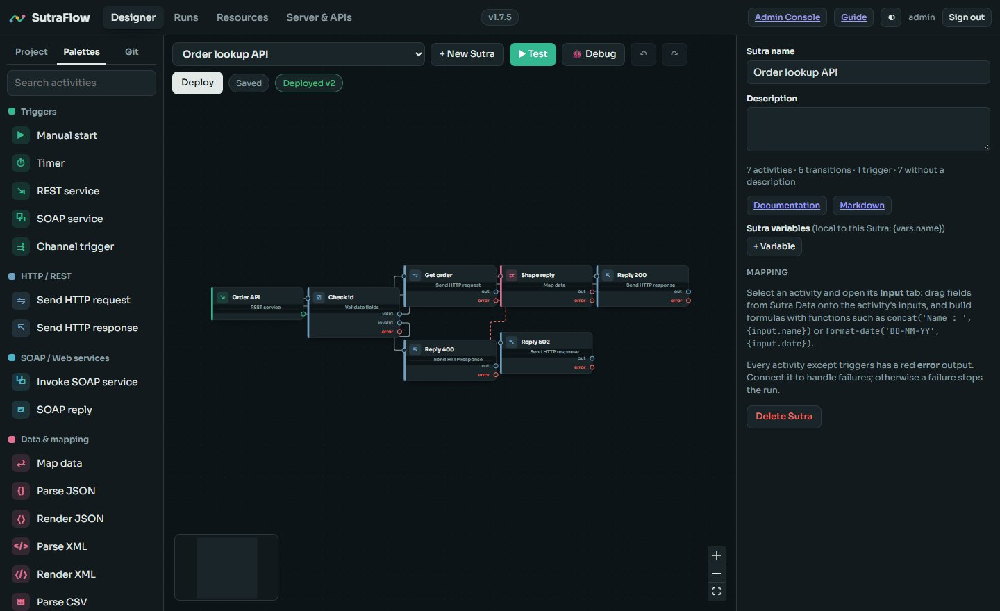
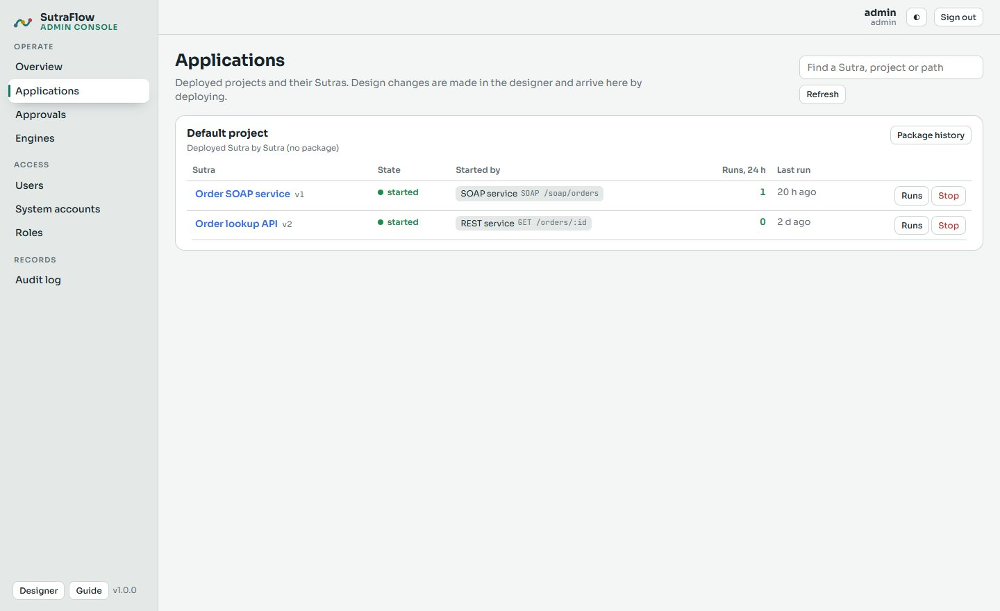

# SutraFlow

**A visual integration designer and engine.** Drag activities onto a canvas, map data between steps, test and debug, and deploy *Sutras* (integration processes) that run as REST, SOAP and MCP services, on schedules, or on events: files, queues, mail, cloud drives, chat messages and more.


[](LICENSE)
[](COMMERCIAL-LICENSE.md)




## Contents

- [Features](#features)
- [Download](#download)
- [Quick start](#quick-start)
- [Documentation](#documentation)
- [Palettes](#palettes)
- [Running Python](#running-python)
- [Releases and CI/CD](#releases-and-cicd)
- [Running in production](#running-in-production)
- [Performance and sizing](#performance-and-sizing)
- [Configuration](#configuration)
- [Development](#development)
- [Project layout](#project-layout)
- [Testing](#testing)
- [Known limitations](#known-limitations)
- [Contributing](#contributing)
- [Security](#security)
- [License](#license)

## Features

- **Visual designer**: 129 activities in 20 palettes, drag-and-drop data mapping with For-Each, Where, Group by and Sort by, more than 100 formula functions, JSONata, live previews, step-by-step debugging with breakpoints, undo and redo, folders, and a description on every step.
- **Durable engine**: every step is checkpointed in the database; approvals and long waits cost nothing while they wait; runs survive restarts and resume where they stopped; retries with backoff, error branches, an Error handler, loops, Merge, sub-Sutras, and resubmitting failed runs from the failed step. Short request-reply Sutras can run **in memory** instead, saved once when they end, several times faster.
- **Memory tables**: small reference data (rates, codes, routing, reusable values) in each engine's memory for lookups without a database round trip, loaded from a query or filled by Sutras, with a failsafe copy, hot reload from the Admin Console and enforced limits.
- **Connection limits**: protect a system behind a connection with Maximum concurrent activities, counted across all engines for Sutra steps (including connections used behind the scenes, such as a knowledge base's database), listener polls and scheduled refreshes; waiting steps keep their place without using retries; per-server values from Project properties; watched in the Admin Console with graphs.
- **Big files on small servers**: CSV and line files of any size are streamed in batches of rows, each batch a step of its own, so memory depends on the batch, not the file.
- **APIs and gateway**: REST, SOAP and WebSocket services with generated WSDL and OpenAPI; security policies (API keys, Basic, JWT, OAuth token introspection, HMAC-signed requests, mutual TLS, WS-Security UsernameToken, X.509 signatures and SAML assertions, encrypted SOAP, IP allow lists, rate limits, CORS); scopes per service and operation; bodies validated against JSON Schema or XSD; threat protection (depth, fields, sizes, no DOCTYPE); gateway apps with keys, OAuth client-credentials tokens, plans and a firewall; TLS with your own certificate or Let's Encrypt.
- **AI**: AI steps (prompt, classify, route, extract, summarize, translate, sentiment) on Claude, OpenAI, Gemini, Ollama and other providers; AI agents with tools, memory, guardrails, people in the loop and hand-offs; knowledge bases for RAG (built-in, pgvector, Qdrant, Chroma, Pinecone); Sutras published as MCP tools for Claude and other assistants; agents as chat pages, an OpenAI-compatible API and A2A.
- **Connectors**: HTTP, SOAP with WS-Security, files, SFTP and FTP, PostgreSQL, MySQL, SQL Server, Oracle and SQLite, MongoDB (documents, aggregation and bulk write), Kafka, RabbitMQ and ActiveMQ, email, Firebase, Google Drive, Sheets and Docs, SharePoint and OneDrive, Dropbox, YouTube, Twitch, Discord, Telegram, Facebook Pages, Azure Data Factory, Databricks, Python, PowerShell and shell scripts, and any OAuth REST API.
- **Operations**: an Admin Console for deployed applications (start, stop, tuning, runs, approvals, engines, alerts, gateway traffic, connection limits, users and roles, system accounts, audit log, releases, the database), with graphs drawn by Apache ECharts; clusters of engines on PostgreSQL with a leader, failover and graceful drain; Prometheus metrics, OpenTelemetry traces and JSON logs; single sign-on for people with OpenID Connect or SAML 2.0, with roles from identity-provider groups.
- **Releases**: projects in Git from the designer; release zips with the deployment config, documentation and files; built by a CI/CD pipeline straight from Git with the `sutra` command; deployed by command line or the Admin Console, with history and rollback.
- **Documentation from the design**: each Sutra and project produces its own documentation (HTML and Markdown) from its steps and their descriptions.



## Download

Each release has a Windows zip and a Linux tar.gz, already built, with SHA-256 files and offline archives (packages included) on the GitHub Releases page. Unpack, run `bin/sutraflow setup` (Windows: `bin\sutraflow.cmd setup`), then `bin/sutraflow start`. Steps for each system and for upgrades: [RELEASE-NOTES.md](RELEASE-NOTES.md).

## Quick start

**Requirements**: [Node.js](https://nodejs.org) 22.13 or later (24 recommended). Nothing else: the database is SQLite, built into Node. Python 3, PostgreSQL, Docker and AI models are optional.

```bash
git clone https://github.com/spinny007/SutraFlow.git
cd SutraFlow
bin/sutraflow setup     # npm install, build, and sutraflow.env      (Windows: bin\sutraflow.cmd setup)
bin/sutraflow start     # the studio, in the background
bin/sutraflow open      # http://127.0.0.1:4800
```

Create the administrator account on the first visit, then **+ New Sutra → Samples** for working examples, or **New project → Package file → Or a sample project** for a whole project (an AI document assistant over a folder of PDF, Word and PowerPoint files).

The `sutraflow` launcher is the one place for every command on Windows and Linux: `start [engine]`, `stop [engine|all]`, `restart`, `status`, `logs [--follow]`, `open`, `cli <sutra command>`, `db`, `service` (start with the machine) and `docker [cluster] up|down|status|logs|build`. Settings are in `sutraflow.env`.

| Port | Default | For |
|---|---|---|
| Studio (admin) | `127.0.0.1:4800` | The designer, the Admin Console (`/admin`), the user guide (`/guide`) and the admin API. Keep it private. |
| Gateway | `8080` (HTTP), `8443` (HTTPS) | The deployed Sutras: REST, SOAP, MCP, agents, `/oauth/token`, `/openapi.json`, `/health`. |
| Headless engine | `4801`, gateway `9080` / `9443` | An engine without the designer, beside the studio or on other machines. |

## Documentation

| Document | What it covers |
|---|---|
| [User guide](docs/sutraflow-user-guide.html) (also at `/guide`) | 50 chapters: every screen, every activity with its settings, connection types, functions; designing Sutras, how the engine runs them, AI, RAG step by step, the API gateway, releases and CI/CD, PostgreSQL, the data tables, production. |
| [Architecture](docs/sutraflow-architecture.html) (also at `/architecture`) | How SutraFlow works inside: every source file, every table, every API route, the settings, with diagrams. |
| [Deployment](docs/deployment.md) | Packages, the `sutra` command, headless engines, Docker, clusters, monitoring. |
| [Engine design](docs/architecture.md) | Runs, tasks, checkpoints and the cluster in short. |
| [Backlog](docs/backlog.md) | Release gates, planned capabilities, implementation guidance and completion criteria. |
| [Laragon (Windows development)](deploy/laragon/README.txt) | Running SutraFlow in Laragon with PostgreSQL. |

The guide and the architecture page are built from the code (`npm run guide`, `npm run architecture`), so they list exactly what the code does.

## Palettes

| Palette | Activities |
|---|---|
| Triggers | Manual start, Timer, REST service, SOAP service, WebSocket service, WebSocket client, Channel trigger |
| HTTP / REST | Send HTTP request, Send HTTP response |
| SOAP / Web services | Invoke SOAP service, SOAP reply |
| WebSocket | WebSocket send (answer, push, broadcast, close), WebSocket client send |
| Data & mapping | Map JSON Data, Map XML Data, Map data (generic), Parse / Render JSON, Parse / Render XML, Parse / Render CSV, Filter list, Sort list, Aggregate, Transform (JSONata) |
| Flow control | If / else, Switch, Router, For each, Merge, Wait, Human approval, Set Local Variable, Get Local Variables, Get Properties, Throw error, End, Call Sutra, Return, Error handler, No operation |
| Files | File trigger, Read file, List / read directory, Write file, Move / copy / delete file |
| SFTP / FTP | Remote file trigger, List, Read, Write, Move / copy / delete remote file |
| DB Ops | SQL query, SQL update, Call procedure, SQL script, SQL transaction |
| Memory tables | Get Memory Record, Set Memory, Query Memory Records, Delete Memory Records, Refresh Memory Table |
| Service Bus | Publish message, Queue / topic trigger, Confirm message (Kafka, RabbitMQ, ActiveMQ / AMQP 1.0) |
| Email | Send email, Email trigger |
| Firebase | Firestore, Realtime Database, Push notification (FCM) |
| Apps and social | Connected API call, Google Sheets, Google Drive / Docs (and trigger), SharePoint / OneDrive (and trigger), Dropbox, YouTube, Facebook Page, Twitch (and live trigger), Discord (and trigger), Telegram (and trigger) |
| Azure Data Factory & Databricks | Run ADF pipeline, ADF pipeline run, ADF run finished trigger, Run Databricks job or notebook, Databricks code block, Databricks SQL |
| Custom code | JavaScript code (sandboxed), HTML template |
| Scripts | Python script, PowerShell script, Shell script, Run program (off until an administrator allows scripts) |
| Release | Build package, Check package, Deploy package, Roll back |
| General | Log, Validate fields, Send to channel, Counter |
| AI | AI prompt, classify, router, extract, summarize, translate, sentiment, Ollama; AI agent, Ask a person, Hand off to agent, memory, knowledge (add, read document text, search, ask, remove, embed), Call MCP tool, Agent channel, Agent reply, AI guard, AI tool, Reply to AI |

Every activity except triggers has an **error** output, retries with backoff, a time limit, a breakpoint, a loop setting, and a description. Connections (24 kinds) are shared per project with secrets kept in an encrypted vault and named, never copied.

Every process starter is marked **▶** in the palette row. Starters stay with the activities they relate to: File trigger is under Files, Email trigger under Email, Queue / topic trigger under Service Bus, and the cloud, chat, ADF, agent and MCP starters under their own palettes. REST service is also the inbound webhook/API starter. All palettes and transition-line conditions accept Project variables: use the **{x}** picker in General settings, connection resources and a selected transition, or `{gv.NAME}` in mapped Input formulas. A selected conditional transition also has a browsable Condition data tree for the previous activity, earlier activities, trigger data, Local variables, Project properties and Engine properties. Gateway paths and limits, schedules, listener settings, nested connection headers and administrator-controlled SQL text resolve them at runtime. SQL text and procedure names accept only Project/Engine properties; request, trigger and prior-step data are rejected there and must use bound `:name` parameters.

The Queue / topic trigger is owned only by the elected leader. In client mode it acknowledges after the Sutra succeeds; explicit mode waits for Confirm message. Its durable duplicate guard survives leader changes, using Kafka topic/partition/offset or a RabbitMQ/AMQP message id. External RabbitMQ and AMQP publishers should therefore assign a unique message id; outside side effects should still use an idempotency key. Kafka connections support TLS with a private CA, SASL plain/SCRAM and optional client-certificate authentication (private key in the vault); every connection field and secret name may come from a Project or Engine property. RabbitMQ uses AMQP 0-9-1. SutraFlow connects to ActiveMQ over AMQP 1.0 while Java applications may use OpenWire/JMS; ActiveMQ Classic needs <code>transport.transformer=jms</code> on the AMQP connector when the two protocols exchange the same message bodies.

HTTP-only integrations can start from four tested samples: **Kafka REST publish**, **Kafka REST subscribe** (create, subscribe, poll, commit and close), **RabbitMQ HTTP publish and fetch**, and **ActiveMQ REST publish and fetch**. ActiveMQ Classic 6.3 disables its deprecated MessageServlet for security, so the sample uses Jolokia management operations; production message consumers should use AMQP 1.0 or OpenWire/JMS instead. All REST connection URLs, users, CA/origin settings and vault-secret names can come from Project properties.

FTP and SFTP remain connection-driven: every remote-file activity and trigger selects an **FTP server** or **SFTP server** resource. Connection fields—including host, port, user, base folder and the vault-secret name—may use Project variables such as `{{gv.FTP_HOST}}`; deployment configuration can override them before deployment, while the actual password or private key remains in that server's vault. See [Files, streaming, SFTP and FTP](docs/sutraflow-user-guide.html#ch-files).

## Running Python

The **Python script** activity runs Python 3 code written in the designer or a `.py` file on the SutraFlow server. An administrator must first open **Admin Console → Server → Runtime**, enable script activities in the **Scripts** card, and confirm the detected interpreter. From a shell, the same check and configuration are available through:

```bash
bin/sutraflow cli python                         # show the Python used by this server
bin/sutraflow cli python --set /path/to/python  # choose an interpreter
```

You can also set `SUTRA_PYTHON` in `sutraflow.env`, choose an interpreter on an individual activity, or give the activity a virtual-environment folder. SutraFlow otherwise tries the Windows `py` launcher, then `python3` and `python` on `PATH`.

Add **Python script** from the **Scripts** palette. Its Parameters are available as a JSON file and as environment variables; the previous activity's output is another JSON file. Arguments arrive through `sys.argv`. Print JSON on the last line to give structured `result` data to the next activity:

```python
import json, os, sys

params = json.load(open(os.environ["SUTRA_PARAMS_FILE"]))
previous = json.load(open(os.environ["SUTRA_INPUT_FILE"]))
mode = sys.argv[1] if len(sys.argv) > 1 else "standard"

total = sum(float(row.get("amount", 0)) for row in previous.get("lines", []))
print(json.dumps({"orderId": params["orderId"], "mode": mode, "total": total}))
```

The activity returns `stdout`, `stderr`, `exitCode`, elapsed time, output lines and parsed `json`/`result`. A non-zero exit code or uncaught exception fails the activity by default. List imported modules such as `pandas, requests` in **Packages it imports**: the designer and Deploy check the interpreter, syntax, script file, virtual environment and packages before the Sutra runs. SutraFlow does not install packages; install them on the server or in the activity's virtual environment. For ready-to-run designs, choose **+ New Sutra → Samples → Python scripts**. See the user guide's [Python scripts chapter](docs/sutraflow-user-guide.html#ch-python) for all settings and production guidance.

## Releases and CI/CD

A release is a zip with the whole project (Sutras at fixed versions, connections without secret values, schemas, variables), a deployment config to fill in per environment, documentation and files. Development and test servers may deploy from the designer; production takes release zips only.

```bash
# In a pipeline (GitHub Actions, GitLab, Azure DevOps, Jenkins): build from Git, test, deploy.
sutra package --from-git . --ref YOUR_GIT_REF --version YOUR_PROJECT_VERSION --out orders.zip
sutra test   orders.zip --secrets-from-env
sutra deploy orders.zip --config prod-config.json --server https://prod-engine:4800 --token $TOKEN
sutra rollback --project "Orders" --server https://prod-engine:4800 --token $TOKEN
```

Full pipelines for GitHub Actions, GitLab CI, Azure DevOps and Jenkins are in the user guide (*CI/CD pipelines*).

## Running in production

- **Headless engines**: `SUTRA_MODE=engine`, with the Admin Console and the gateway, packages from `SUTRA_DEPLOY_DIR` at start.
- **PostgreSQL and clusters**: move from SQLite with one button (Admin Console → Database → Migrate now) or `tools/migrate-to-postgres`; then add engines on the same database. Work is shared, one live claim owns a task, claim fencing rejects stale completions, a leader runs timers and listeners with failover, and a stopped engine's unfinished work is recovered by another.
- **Docker**: `Dockerfile`, `docker-compose.yml` (studio and engine) and `docker-compose.cluster.yml` (PostgreSQL, a studio and two engines).
- **Monitoring**: `/health`, `/ready`, Prometheus `/metrics`, OpenTelemetry traces, JSON logs, alert rules (failed runs, slow runs, waiting approvals, gateway errors, engines, certificates) to email, webhooks or Sutras.
- **Sign-in on production servers**: secrets per server vault; Azure managed identities or service principals; OAuth accounts connected with `sutra connect` or a refresh token secret.

See [docs/deployment.md](docs/deployment.md) and the user guide's *Running in production*.

## Performance and sizing

SutraFlow sizes itself: an engine takes its steps at once, queue check and settings refresh from the machine it runs on (from 1 vCPU / 1 GB up), unless environment variables set them. The Admin Console (*Engines → Tuning → This machine*) shows the profile and applies it; `sutra engines machine` prints it.

- Load test: `node tools/loadtest.mjs` (durable or in memory, one or more engines, small or big outputs, a killed engine, a soak, one core and a small heap); big files: `node tools/bigfiletest.mjs`.
- Results measured for this release are in [docs/benchmarks](docs/benchmarks), and explained in the user guide's *Sizing and performance*, with which services suit which machine and what file sizes to read whole or stream.

## Configuration

Settings are environment variables, set in `sutraflow.env` for the launcher. The most used:

| Variable | Default | Meaning |
|---|---|---|
| `SUTRA_DATA_DIR` | `./data` | Data folder: SQLite database, master key, logs, project files |
| `SUTRA_DB` | (SQLite) | `postgres://user@host:5432/sutraflow` for PostgreSQL; password in `SUTRA_DB_PASSWORD` |
| `SUTRA_MASTER_KEY` | `data/master.key` | Vault key (base64, 32 bytes); the same on every engine of a cluster |
| `SUTRA_MODE` | `studio` | `engine` for a headless engine |
| `SUTRA_ENVIRONMENT` | `development` | `development`, `test` or `production` (production refuses designer deploys) |
| `SUTRA_ADMIN_HOST`, `SUTRA_ADMIN_PORT` | `127.0.0.1`, `4800` | Studio and admin API |
| `SUTRA_GATEWAY_HTTP_PORT`, `SUTRA_GATEWAY_HTTPS_PORT` | `8080`, `8443` | Gateway |
| `SUTRA_WORKERS` | by machine | Steps one engine runs at once (4 on 1 vCPU / 1 GB, up to 32) |

Every setting is listed in the architecture page (*Settings*); the build fails when the code reads one it does not list.

## Development

```bash
npm install
npm run dev            # studio with hot reload on http://localhost:5173 (API proxied to 4800)
npm test               # the whole test suite (builds first)
npm run typecheck      # server and web
npm run build          # production build into dist/
npm run vendor:check:online # verify reviewed vendor trees and check npm for newer upstream releases
npm run guide          # rebuild the user guide from the code
npm run guide:shots    # retake the guide's screenshots from a running server (headless Edge or Chrome)
npm run architecture   # rebuild the architecture page
npm run samples        # rebuild the sample project zips in samples/
```

Stack: Node.js and TypeScript, Fastify, React with React Flow, Vite; SQLite (`node:sqlite`) or PostgreSQL.

Local dependency forks are controlled by [`vendor/vendor-lock.json`](vendor/vendor-lock.json). Every build verifies their normalized source hashes, package-lock links, licences, consumers, focused tests and runtime/test-only packaging policy. Connected CI and release jobs additionally compare the reviewed versions and tarball integrity with npm; a weekly workflow detects new upstream versions even when no code is pushed. An update is never copied automatically: it must be reviewed for API and behavior changes, the documented patches must be reapplied, and focused plus complete regression tests must pass. See [`vendor/README.md`](vendor/README.md).

## Project layout

```
bin/                    the sutraflow launcher (Windows .cmd, Linux and macOS sh)
server/src/             the server: engine, gateway, admin API, connectors, palettes, AI, Git, the sutra command
web/src/                the designer (React)
web/admin/              the Admin Console (React)
tools/                  builds of the guide, architecture page and sample zips; migrate-to-postgres
docs/                   user guide, architecture page, deployment and design notes, guide screenshots
samples/                sample project zips (release zips with their files)
deploy/                 Laragon and other deployment templates
test/                   the test suites
```

## Testing

The suite has 475 declared tests; executed totals also include nested cases and environment-dependent skips. It uses real child processes and network calls for HTTP, SOAP with WS-Security, TLS, SMTP, Kafka, RabbitMQ, AMQP 1.0/OpenWire JMS, SFTP and FTP servers, SQLite, Python, multi-process clusters, the launcher and the command-line tool. Real PostgreSQL and MySQL integration tests are the database release gate. PGlite also runs the in-process suite through PostgreSQL compatibility as fast secondary regression coverage; it does not replace testing against PostgreSQL. Atlas M0 checks use explicit opt-in and isolated seeded collections; see the [2.0.10 verification record](docs/releases/2.0.10-verification.md) before treating candidate capabilities as shipped activities. For file purposes, connected modules and entry points, see [code navigation](docs/code-navigation.md); maintain it with `node tools/file-overviews.mjs` and verify with `--check`.

The process-level tests exercise the central durability claims directly: engines share work without duplicating completed steps, elect and replace a leader, recover work from an engine killed mid-step, hand work back during drain, persist approvals and long waits without holding a worker, and deploy and call packages through both local and remote CLI paths.

The release gate uses a real PostgreSQL server for DB Ops steps (queries, bound parameters, transactions, plpgsql install scripts, procedures with output parameters), database migration and cluster behavior (`SUTRA_TEST_PG_URL`), PostgreSQL tools for password- and SSL-protected migration (`SUTRA_TEST_PG_BIN`), OpenSSL for the temporary TLS test server, and a real MySQL server for Sutra-driven INSERT, UPDATE and SELECT operations, bound-parameter injection safety, transaction rollback, install scripts and stored procedures (`SUTRA_TEST_MYSQL_URL`). On Windows the TLS test automatically checks Git for Windows and Laragon's Git copy when `openssl` is not on `PATH`; `SUTRA_TEST_OPENSSL` is the explicit override. This OpenSSL executable is a test prerequisite only: SutraFlow's runtime TLS and ACME implementation use Node cryptography and do not shell out to OpenSSL. The database-specific cases are skipped only for a developer's reduced local run when these variables are absent; release and Linux CI runs must supply both databases. With Laragon's MySQL, PostgreSQL and Git OpenSSL in PowerShell:

```powershell
$env:SUTRA_TEST_PG_URL = 'postgres://postgres@127.0.0.1:5432/postgres'
$env:SUTRA_TEST_MYSQL_URL = 'mysql://root@127.0.0.1:3306/sutraflow_test'
$env:SUTRA_TEST_PG_BIN = 'C:/laragon/bin/postgresql/postgresql/bin'
$env:SUTRA_TEST_OPENSSL = 'C:/laragon/bin/git/mingw64/bin/openssl.exe'
npm test
``` The pgvector storage path is covered with a protocol-compatible test server; run an additional deployment test against the intended PostgreSQL/pgvector version before relying on it in production.

Tested against stand-in services that answer like the real ones, but not yet against the real services: SQL Server, Oracle, IMAP, Let's Encrypt, Qdrant, Chroma, Pinecone, and the Google, Microsoft, Dropbox, YouTube, Twitch, Discord, Telegram, Facebook, Azure Data Factory and Databricks APIs. The v2.0.8 gate covers RabbitMQ 4.4 over AMQP 0-9-1 and ActiveMQ Classic 6.3 over AMQP 1.0, including two-way Java OpenWire/JMS interoperability, plus hosted Aiven Kafka with TLS+SASL PLAIN and mutual TLS. The native matrices passed 66 scenario executions, including JSON/XML/text/map/bytes and malformed-payload retry limits. Four REST checks passed, including every generated broker REST sample. External PostgreSQL 17.2 and MariaDB 11.8.9 also passed TLS-verified connector and engine SQL-query checks; these do not replace the pending 24-hour separate-machine soak. See the [messaging certification record](docs/sutraflow-architecture.html#messaging-certification) for tested configurations and limits.

## Known limitations

- **Twitch and Discord triggers** poll (every minute and every few seconds) rather than receive pushed events.
- **The soak test** covers the starters that run on one machine. Email (IMAP) and cloud triggers still use stand-ins in the normal suite; broker certification is a separate opt-in real-service gate so CI never needs production credentials.

## Contributing

Contributions are welcome: see [CONTRIBUTING.md](CONTRIBUTING.md). Code and documentation contributions need the [Contributor License Agreement](CLA.md), agreed once in your first pull request: you keep your copyright, and your contribution is published under the AGPL and may also be offered under commercial licences.

## Security

Secrets are encrypted in a vault, the studio stays on 127.0.0.1 with roles and an audit log, and gateway services are protected by policies and TLS. Report security problems privately: see [SECURITY.md](SECURITY.md).

## License

SutraFlow is **dual-licensed**:

- **[GNU Affero General Public License v3.0](LICENSE)**: free for everyone. Use, change and run it for any purpose; if you change SutraFlow and people use your changed version over a network, or you distribute it, you share your changes under the AGPL.
- **[Commercial licence](COMMERCIAL-LICENSE.md)**: for organisations that do not want to share their changes, for example in-house deployments with private changes, or SutraFlow inside a proprietary product or service. Terms per customer; contact [mixagile.com](https://mixagile.com).

Running SutraFlow unchanged needs no commercial licence, and the Sutras, projects and packages you build with it are yours, whichever licence applies.

Copyright (C) Surya Partap Singh and SutraFlow contributors.
