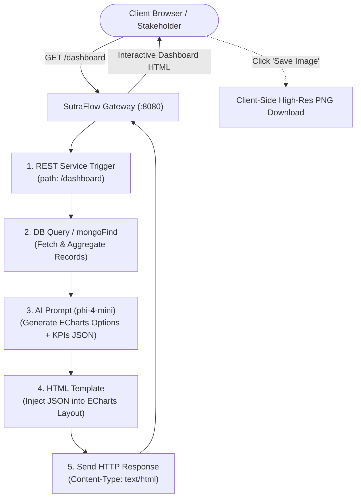

# AI-Driven Dynamic Dashboards with Apache ECharts & SutraFlow

**Author / Project:** SutraFlow Architecture & Integration Guide  
**Applies To:** SutraFlow v2.0+ (Node.js 22+, Fastify Gateway, React 19 Studio)  
**Target Models:** Small Local LLMs (e.g., Microsoft `phi-4-mini` via Ollama / LM Studio) or Cloud LLMs (Claude, OpenAI, Gemini)

---

## 1. Executive Summary

This specification explains how to build, host, and automate **interactive, visual data dashboards with high-resolution image exports** using **SutraFlow** and **lightweight text-only LLMs** like **`phi-4-mini`** (3.8B parameters).

### The Core Challenge
Text models cannot directly generate raster image buffers (PNG/JPEG) from scratch. Furthermore, running headless browsers (like Puppeteer) on backend integration servers to capture screenshots is resource-heavy, slow, and prone to memory leaks.

### The Solution: Declarative ECharts + Self-Hosted Gateway
1. **Database-Driven Data Extraction**: SutraFlow extracts raw or pre-aggregated metrics from PostgreSQL, MySQL, SQL Server, Oracle, SQLite, or MongoDB.
2. **Declarative Visualization Specification**: Instead of generating images, `phi-4-mini` outputs a compact, strictly typed **JSON schema** containing KPI summaries and **Apache ECharts** options (`xAxis`, `yAxis`, `series`, `tooltip`, `legend`).
3. **Automated Image Export**: Apache ECharts natively includes high-DPI image rasterization via its built-in `toolbox.feature.saveAsImage` feature, providing instant one-click PNG downloads directly in the user's browser.
4. **Self-Hosted Gateway**: SutraFlow’s built-in Fastify gateway exposes the Sutra as an HTTP service (`GET /dashboard`), rendering the complete dashboard on port `8080` (or `8443` HTTPS) with sub-second latency.

---

## 2. End-to-End Architectural Flow



---

## 3. Method 1: Ready-to-Run (Using Built-In Palettes)

This approach requires **no codebase modifications**. You build the workflow entirely within the SutraFlow visual canvas.

### Step 1: Inbound HTTP Trigger (`restService`)
* **Palette**: `Triggers`
* **Activity**: `REST service`
* **Configuration**:
  * **Method**: `GET`
  * **Path**: `/dashboard` (or `/dashboard/:department`)
  * **API Security Policy**: Optional (leave empty for public internal dashboards, or select an inbound policy for API key / JWT / Basic auth).

### Step 2: Database Query (`sqlQuery` or `mongoFind`)
* **Palette**: `DB Ops` (or `MongoDB`)
* **Activity**: `SQL query` (or `mongoFind`)
* **Configuration**: Select your database connection resource.
* **SQL Best Practice**: Pre-aggregate metrics in the database query. This ensures `phi-4-mini` only processes 10–50 high-signal rows rather than thousands of raw transactions:
  ```sql
  SELECT 
    category,
    TO_CHAR(order_date, 'YYYY-MM') AS period,
    SUM(amount) AS total_revenue,
    COUNT(*) AS total_orders
  FROM orders
  WHERE order_date >= NOW() - INTERVAL '6 months'
  GROUP BY category, TO_CHAR(order_date, 'YYYY-MM')
  ORDER BY period ASC;
  ```
* **Output**: Accessible in downstream steps as `{sqlQuery.rows}`.

### Step 3: AI Prompt with `phi-4-mini` (`aiPrompt`)
* **Palette**: `AI`
* **Activity**: `AI prompt`
* **AI Provider Connection**: Point to an Ollama connection (`http://127.0.0.1:11434`) running `phi4-mini`.
* **System Instructions**:
  ```text
  You are an expert data analyst and Apache ECharts engineer.
  Analyze the provided database records and return ONLY a single, valid JSON object (no markdown fences, no code blocks, no conversational preamble).

  Follow this JSON contract exactly:
  {
    "title": "Executive Performance Dashboard",
    "summary": "Revenue experienced steady 14% growth led by Enterprise accounts.",
    "kpis": [
      { "label": "Total Revenue", "value": "$482,900", "trend": "+14.2%" },
      { "label": "Orders", "value": "1,248", "trend": "+8.1%" },
      { "label": "Top Category", "value": "Cloud Services", "trend": "54% share" }
    ],
    "charts": [
      {
        "id": "chart_revenue_trend",
        "title": "Monthly Revenue Trend",
        "option": {
          "tooltip": { "trigger": "axis" },
          "toolbox": { "feature": { "saveAsImage": { "title": "Save PNG", "pixelRatio": 2 } } },
          "xAxis": { "type": "category", "data": ["Jan", "Feb", "Mar", "Apr", "May", "Jun"] },
          "yAxis": { "type": "value" },
          "series": [{ "data": [45000, 52000, 58000, 64000, 71000, 82000], "type": "line", "smooth": true, "color": "#2563eb" }]
        }
      },
      {
        "id": "chart_category_share",
        "title": "Revenue by Category",
        "option": {
          "tooltip": { "trigger": "item" },
          "toolbox": { "feature": { "saveAsImage": { "title": "Save PNG", "pixelRatio": 2 } } },
          "series": [{
            "type": "pie",
            "radius": ["40%", "70%"],
            "data": [
              { "value": 260000, "name": "Cloud Services" },
              { "value": 140000, "name": "Consulting" },
              { "value": 82900, "name": "Licenses" }
            ]
          }]
        }
      }
    ]
  }
  ```
* **Prompt Field**:
  ```text
  Here is the summarized database data:
  {{sqlQuery.rows}}
  ```
* **Output**: SutraFlow automatically extracts balanced JSON from `{aiPrompt.text}`.

### Step 4: HTML Template Generation (`htmlTemplate`)
* **Palette**: `Custom code`
* **Activity**: `HTML template`
* **HTML Field**:
  ```html
  <!DOCTYPE html>
  <html lang="en">
  <head>
    <meta charset="UTF-8">
    <meta name="viewport" content="width=device-width, initial-scale=1.0">
    <title>SutraFlow AI Dashboard</title>
    <!-- Apache ECharts CDN -->
    <script src="https://cdn.jsdelivr.net/npm/echarts@5.5.0/dist/echarts.min.js"></script>
    <style>
      :root {
        --bg-color: #f8fafc;
        --card-bg: #ffffff;
        --text-primary: #0f172a;
        --text-secondary: #64748b;
        --border-color: #e2e8f0;
        --primary: #2563eb;
      }
      body {
        font-family: -apple-system, BlinkMacSystemFont, "Segoe UI", Roboto, sans-serif;
        background-color: var(--bg-color);
        color: var(--text-primary);
        margin: 0;
        padding: 32px 24px;
      }
      .container { max-width: 1200px; margin: 0 auto; }
      .header { margin-bottom: 28px; }
      .header h1 { margin: 0 0 8px 0; font-size: 28px; font-weight: 700; }
      .header p { margin: 0; color: var(--text-secondary); font-size: 15px; line-height: 1.5; }
      
      .kpi-grid {
        display: grid;
        grid-template-columns: repeat(auto-fit, minmax(220px, 1fr));
        gap: 16px;
        margin-bottom: 24px;
      }
      .kpi-card {
        background: var(--card-bg);
        border: 1px solid var(--border-color);
        border-radius: 10px;
        padding: 20px;
        box-shadow: 0 1px 3px rgba(0,0,0,0.05);
      }
      .kpi-label { font-size: 13px; font-weight: 600; color: var(--text-secondary); text-transform: uppercase; }
      .kpi-val { font-size: 28px; font-weight: 800; color: var(--text-primary); margin: 6px 0; }
      .kpi-trend { font-size: 13px; color: #16a34a; font-weight: 600; }

      .chart-grid {
        display: grid;
        grid-template-columns: repeat(auto-fit, minmax(500px, 1fr));
        gap: 20px;
      }
      .chart-card {
        background: var(--card-bg);
        border: 1px solid var(--border-color);
        border-radius: 10px;
        padding: 20px;
        box-shadow: 0 1px 3px rgba(0,0,0,0.05);
      }
      .chart-card h3 { margin: 0 0 16px 0; font-size: 17px; font-weight: 600; }
      .chart-box { width: 100%; height: 360px; }

      .footer-actions {
        margin-top: 32px;
        display: flex;
        gap: 12px;
      }
      .btn {
        background: var(--primary);
        color: #ffffff;
        border: none;
        padding: 10px 18px;
        border-radius: 6px;
        font-weight: 600;
        cursor: pointer;
        transition: background 0.2s;
      }
      .btn:hover { background: #1d4ed8; }
    </style>
  </head>
  <body>
    <div class="container">
      <div class="header">
        <h1 id="dashTitle">Executive Dashboard</h1>
        <p id="dashSummary"></p>
      </div>

      <div class="kpi-grid" id="kpis"></div>
      <div class="chart-grid" id="charts"></div>

      <div class="footer-actions">
        <button class="btn" onclick="window.print()">🖨️ Print / Save Full Dashboard PDF</button>
      </div>
    </div>

    <script>
      // Inject AI JSON payload safely using unescaped triple-braces
      const spec = {{{aiPrompt.text}}};

      document.getElementById('dashTitle').textContent = spec.title || 'Analytics Dashboard';
      document.getElementById('dashSummary').textContent = spec.summary || '';

      // Mount KPI Cards
      const kpis = spec.kpis || [];
      const kpiContainer = document.getElementById('kpis');
      kpis.forEach(k => {
        kpiContainer.innerHTML += `
          <div class="kpi-card">
            <div class="kpi-label">${k.label}</div>
            <div class="kpi-val">${k.value}</div>
            <div class="kpi-trend">${k.trend}</div>
          </div>`;
      });

      // Mount ECharts Instances
      const charts = spec.charts || [];
      const chartContainer = document.getElementById('charts');
      charts.forEach(c => {
        const card = document.createElement('div');
        card.className = 'chart-card';
        card.innerHTML = `<h3>${c.title}</h3><div id="${c.id}" class="chart-box"></div>`;
        chartContainer.appendChild(card);

        const chart = echarts.init(document.getElementById(c.id));
        
        // Ensure one-click image download toolbox is enabled
        if (!c.option.toolbox) c.option.toolbox = { feature: {} };
        if (!c.option.toolbox.feature) c.option.toolbox.feature = {};
        c.option.toolbox.feature.saveAsImage = {
          show: true,
          title: 'Download High-Res PNG',
          pixelRatio: 2
        };

        chart.setOption(c.option);
        window.addEventListener('resize', () => chart.resize());
      });
    </script>
  </body>
  </html>
  ```

### Step 5: Serve the Page (`sendHttpResponse`)
* **Palette**: `HTTP / REST`
* **Activity**: `Send HTTP response`
* **Configuration**:
  * **Status Code**: `200`
  * **Content Type**: `text/html`
  * **Body**: `{{htmlTemplate.html}}`

---

## 4. Method 2: Extending SutraFlow with a Dedicated "Dashboard" Palette

If you wish to provide a first-class, reusable component in SutraFlow so that canvas designers only drop a single activity, implement the following:

### 1. Register the Palette in `server/src/palettes/index.ts`
```typescript
export const PALETTES = [
  ...
  { id: 'dashboard', name: 'Dashboards & Reports', color: 'data' },
  ...
];
```

### 2. Implement `server/src/palettes/dashboard.ts`
```typescript
import type { Activity } from '../engine/types.js';
import { F } from './common.js';

export const dashboardActivities: Activity[] = [
  {
    type: 'echartsDashboard',
    palette: 'dashboard',
    name: 'ECharts Dashboard',
    glyph: '📊',
    ports: ['out'],
    desc: 'Compiles AI-generated KPI metrics and Apache ECharts options into a responsive, self-hosted HTML dashboard with built-in PNG image export.',
    fields: [
      F('title', 'Dashboard Title', 'text', 'Executive Analytics Dashboard', { tpl: true }),
      F('theme', 'Color Theme', 'select', 'default', { options: ['default', 'dark', 'vintage', 'macarons'] }),
      F('spec', 'Dashboard Spec (JSON)', 'code', '{{input}}', { tpl: true, help: 'JSON containing title, summary, kpis, and charts with echart options.' }),
      F('enableImageExport', 'Enable PNG Download Buttons', 'bool', true),
    ],
    outputHint: { html: '', chartCount: 0 },
    execute: async c => {
      let spec = c.v('spec');
      if (typeof spec === 'string') {
        try { spec = JSON.parse(spec); } catch { spec = { summary: spec, charts: [] }; }
      }
      const title = c.resolve(c.raw('title')) || spec.title || 'Analytics Dashboard';
      const theme = c.raw('theme') || 'default';
      const enableExport = c.raw('enableImageExport') !== false;

      const html = renderFullDashboard({ title, theme, spec, enableExport });
      return { out: { html, chartCount: (spec.charts || []).length } };
    },
  },
];

function renderFullDashboard(opts: { title: string; theme: string; spec: any; enableExport: boolean }): string {
  // Returns HTML template embedding Apache ECharts, styling, and client-side mount script
  return `<!DOCTYPE html>...`;
}
```

### 3. Expose in `allActivities` in `server/src/palettes/index.ts`
```typescript
import { dashboardActivities } from './dashboard.js';

export const allActivities = [
  ...
  ...dashboardActivities,
  ...
];
```

---

## 5. Production Tuning & Performance

1. **Enable In-Memory Execution Mode**:
   * For interactive request-reply HTTP services, change the Sutra’s **Execution Mode** from `Durable` to `In-Memory` in the Inspector's Settings tab.
   * In-Memory mode avoids intermediate database checkpoints for each step, delivering sub-100ms response times for data fetching and HTML rendering.
2. **Context Window Optimization for `phi-4-mini`**:
   * `phi-4-mini` has a lightweight footprint. Keep its prompt under 1,500 tokens by utilizing SQL `GROUP BY` and `LIMIT` clauses before feeding data into the prompt.
3. **Response Caching via Memory Tables**:
   * If the dashboard is accessed frequently by multiple users, store the generated HTML in a SutraFlow **Memory Table** (`Set Memory`) with a 5-minute TTL. Use an `If / else` branch to return the cached HTML immediately, refreshing the database query and AI model only when the TTL expires.

---

## 6. Verification Checklist

- [x] Inbound `REST service` handles `GET /dashboard` on gateway port 8080.
- [x] Database query returns clean JSON rows without locking long transactions.
- [x] `phi-4-mini` reliably formats valid ECharts option JSON.
- [x] HTML template uses triple-braces (`{{{aiPrompt.text}}}`) to preserve valid unescaped JSON.
- [x] `toolbox.feature.saveAsImage` allows instant high-DPI PNG chart downloads.
- [x] `window.print()` allows one-click full-page PDF exports.
